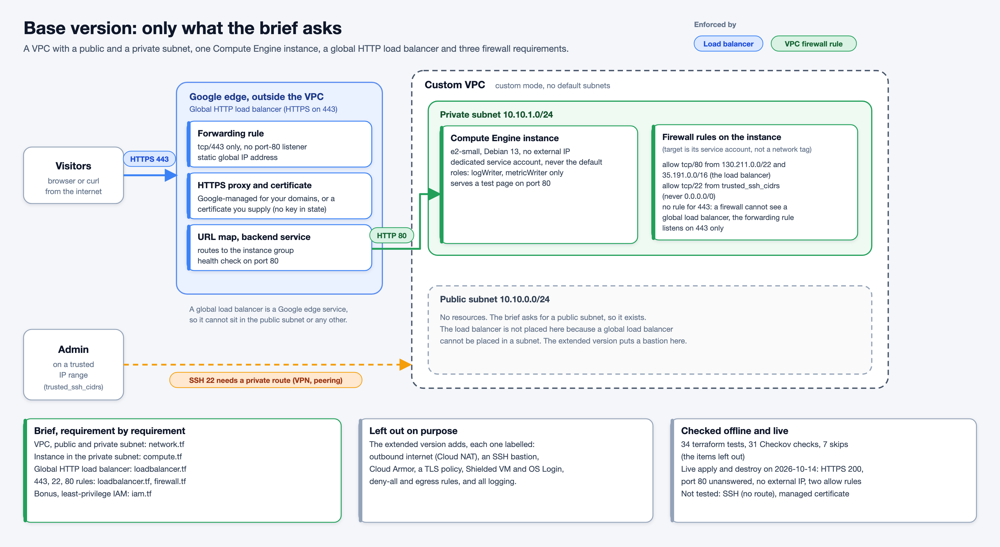
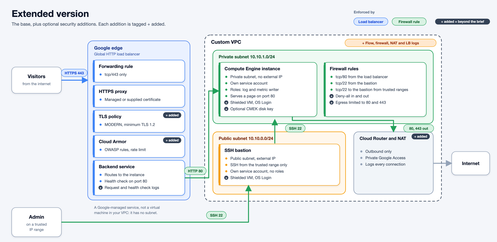

# Part 1: Secure GCP infrastructure with Terraform

The task asks for a Terraform module that deploys, on Google Cloud, a VPC with a public and a private subnet, a Compute Engine instance in the private subnet, a global HTTP load balancer, and three firewall rules (443 from the internet, 22 from a trusted range, 80 from the load balancer). The bonus is least-privilege IAM.

I built it twice, so a reviewer can read the answer to the brief on its own and then see what extra security work I added and why.

| | [`base/`](base/README.md) | [`extended/`](extended/README.md) |
| --- | --- | --- |
| What it is | Only what the brief asks | The base plus labelled security additions |
| Read it to | Check the brief is met | See what I would add and why |
| Resources (live apply) | 20 | 35 |
| `terraform test` | 34 passed | 48 passed |
| Checkov | 31 passed, 7 skips (the items left out) | 98 passed, 1 skip (the bastion's public IP) |
| Verified live | 2026-10-14 | 2026-10-13 |

Both are standalone modules with their own tests and example. Compare them with `diff -ru base extended`.

## Base



## Extended



## What the extended version adds, and why

| Addition | Why |
| --- | --- |
| Shielded VM, OS Login, project SSH keys blocked, serial port off, optional CMEK | Makes a compromised or mis-keyed instance harder to abuse |
| SSH bastion in the public subnet | The instance has no external IP, so a trusted public range cannot reach it. The bastion gives the SSH requirement a working path and gives the public subnet a purpose |
| Per-instance login bindings and an optional IAP rule | Least privilege at resource level, not project-wide |
| Deny-all ingress and egress rules, narrow egress allow | Makes the default deny auditable and limits what a compromised instance can reach |
| Cloud Router, Cloud NAT, Private Google Access | The private instance can fetch updates without a public address |
| TLS policy, minimum TLS 1.2 | Refuses old TLS versions |
| Cloud Armor (OWASP rules, rate limit) | Filters common web attacks at the edge |
| Flow, firewall, NAT, load balancer and health check logs | Detection and investigation |
| Custom Checkov policies and extra tests | Guard rails for things a unit test cannot see |

The details, files and live results are in [`extended/README.md`](extended/README.md).

## Three places where the brief and Google Cloud do not line up

1. **The load balancer is not in the public subnet.** A global external Application Load Balancer is a Google edge service and has no subnet. The public subnet exists because the brief asks for it. It is empty in the base version and holds the bastion in the extended one.
2. **"HTTP" load balancer, but only 443 from the internet.** I read "HTTP load balancer" as the product type and followed the 443 rule: one forwarding rule on tcp/443, no port-80 listener. No VPC firewall rule can express "443 from the internet to the load balancer", because the load balancer is not in the VPC. The forwarding rule is the control.
3. **SSH from a trusted range to a private instance.** With no external IP, a public trusted range cannot reach the instance. The base version keeps the rule the brief asks for and says plainly that it needs a private route (VPN, peering). The extended version adds a bastion so it works.

## How to run

The checks need no GCP credentials. From the repo root:

```sh
make lint test scan
```

That runs `terraform fmt -check`, `terraform validate`, `tflint`, `terraform test` (mocked `google` provider) and `checkov` on both modules. To deploy, copy the module's `examples/basic/main.tf`, set `project_id`, `trusted_ssh_cidrs` and either `domains` or `existing_ssl_certificate_id`, then run `terraform init`, `plan` and `apply` with your own credentials.

## Layout

| Path | Content |
| --- | --- |
| `base/` | Module with only the brief, tests, example, README |
| `extended/` | Module with the additions, tests, example, README |
| `policy/checkov/` | Three custom Checkov policies shared by both: no `roles/editor` or `roles/owner`, forwarding rule on tcp/443 only, no ingress allow from the whole internet |
| `docs/` | The two diagrams (PNG and SVG source) |
| `part.mk` | Make targets for both modules |

## Honest limits

- Verified live with a self-signed certificate. The Google-managed certificate, TLS 1.1 refusal, IAP and CMEK were not exercised.
- The live runs used a project owner account, so the deployer role tables in each README are not proven.
- The mock-provider tests cannot catch what a real API rejects or how resources behave when replaced. Two defects in the extended version were found only by applying it, and are documented in its README.
- This is a take-home exercise, not a production design.
